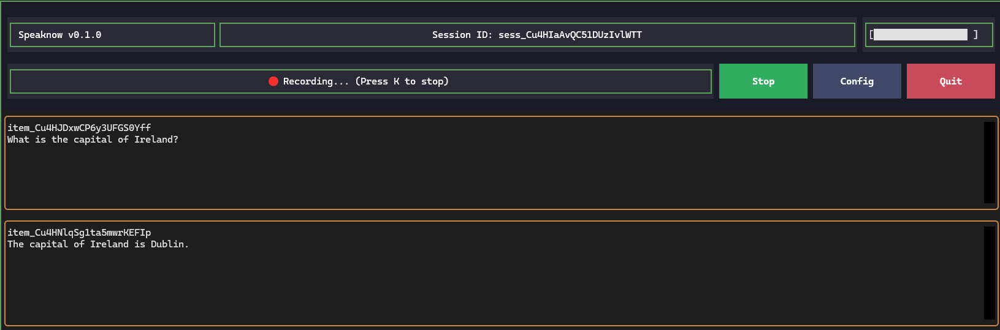
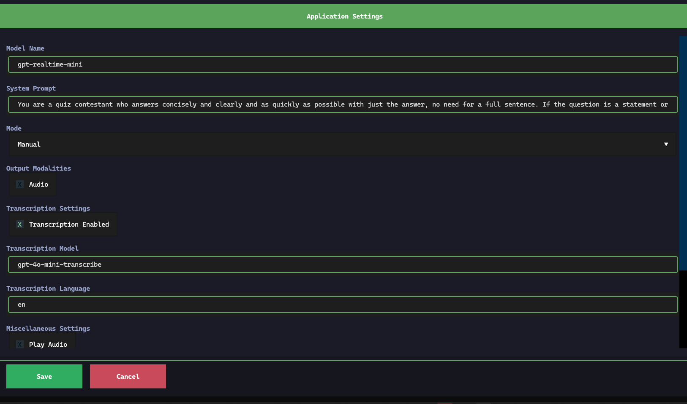

# SpeakNow

SpeakNow is a high-performance, real-time AI voice interface that runs on OpenAI Realtime API, Google Gemini Flash Native Audio Live API, Grok Voice, or ElevenLabs Realtime. It provides a seamless, low-latency speech-to-speech conversational experience directly in your terminal.

In additional to the textual TUI, various parts of the code can be used in other applications as a library particularly the code in ```speaknow_ai_realtime_text_to_speech.py/ai_services``` path. Documentation for a stable API is planned in near future.
This project is based on and inspired by the `push_to_talk_app.py` example from the [openai-python](https://github.com/openai/openai-python/blob/main/examples/realtime/push_to_talk_app.py) repository but with lots of features added and support for other AI services.

## Features

* **Low-Latency Speech-to-Speech:** Direct multimodal interaction using the `gpt-realtime` or `gpt-realtime-mini` or ``gemini-2.5-flash-native-audio`` models for near-instant responses.
* **Real-time Transcription:** View live streaming transcripts of your conversation as you speak.
* **Configurable Parameters:** Easily adjust system prompts, model names, mode, and transcription options through a built-in TUI settings menu.
* **Professional TUI:** A clean, "sticky" interface with persistent headers, footers, and scrollable settings panes using ```textual```.
* **Voice Amplitude Monitor:** Monitor the volume of the voice input

## Installation

SpeakNow requires **Python 3.11 or greater**.

To install the latest version from PyPI, run:

```bash
pip install speaknow-gui
```

On Windows ffmpeg is required:

```bash
winget install --id=Gyan.FFmpeg
```


For linux, portaudio19-dev and ffmpeg are required. For example, to install on Ubuntu:

```bash
sudo apt install portaudio19-dev ffmpeg
```

## Development tests

Install the application and test dependencies, then run pytest:

```bash
python -m pip install -e ".[test]"
python -m pytest
python -m pytest --cov --cov-report=term-missing
```

Tests use temporary application directories and fake API clients/audio streams.
They do not need API keys, microphone access, or live API requests.

## Usage

### Configuration
Before running, ensure your OPENAI_API_KEY is set in your environment variables as minimum. 
GEMINI_API_KEY, XAI_API_KEY, and ELEVENLABS_API_KEY can also be set if those services are needed.

In Windows open the Edit Environmnent Variables GUI and add it there.

In Linux:
```bash
export OPENAI_API_KEY="your-api-key-here"
```

SpeakNow provides two main entry points for different use cases.
If the script doesn't work, make sure the scripts path for Python is included in the PATH Environment Variable.


### 1. Standard Application
Launch the main TUI application to start a real-time session:

Windows:
```powershell
speaknow.exe
```

Linux:
```bash
speaknow
```




### 2. Web Service Mode
Run a server-side version optimized for shared or remote environments:

Windows:
```powershell
speaknow-serve.exe
```

Linux:
```bash
speaknow-serve
```

### Modes:
The mode can be changed in configuration.
Manual mode is triggered by hitting "Start," speaking and then hitting "Stop." to send the audio.
Server VAD and uses periods of silence to automatically chunk the audio.
Semantic VAD  uses a semantic classifier to detect when the user has finished speaking, based on the words they have uttered.
This setting will be ignored in Gemini which uses it's default VAD mechanism only.

### ElevenLabs Realtime

Set `ELEVENLABS_API_KEY`, open Settings (`C`), and select **ElevenLabs Realtime**.
The default is `eleven_realtime_v1_mini`, optimized for speed; you can change the
model to `eleven_realtime_v1_max` for more complex tasks. No dashboard agent ID
is required. Keep the base URL as `https://api.elevenlabs.io/v1/convai`.

The service uses 24 kHz PCM audio, the Brian voice, and semantic turn detection.
Speak normally and allow a pause for the reply. Manual turn commits, separate
transcription model/language selection, and local cost tracking are not exposed
for this provider. Configure the system prompt in SpeakNow as usual.

Authentication uses a fresh short-lived client secret for each WebSocket
connection, following the [ElevenLabs Realtime compatibility guide](https://elevenlabs.io/docs/eleven-agents/guides/openai-realtime-compatibility).
That guide currently documents browser clients; this adapter uses the same
protocol through the Python OpenAI SDK. Automated tests mock the service;
a live account is needed to verify end-to-end audio and account access.

### Application Data

Logs, token usage and config file (can also be modifed in the TUI) will be stored here:

* Windows: %APPDATA%\Speaknow
* Windows when python is installed from Microsoft Store path will be something like: %LOCALAPPDATA%\Packages\PythonSoftwareFoundation.Python.3.1<....>\LocalCache\Roaming\Speaknow
* Linux: $HOME/.config/Speaknow
